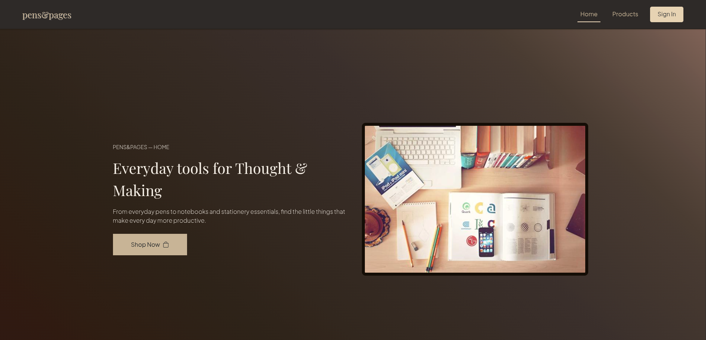
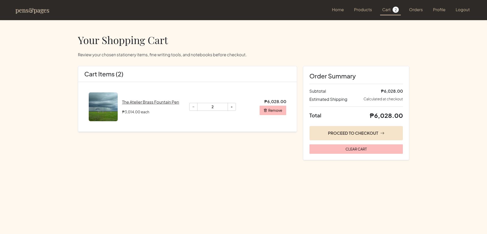
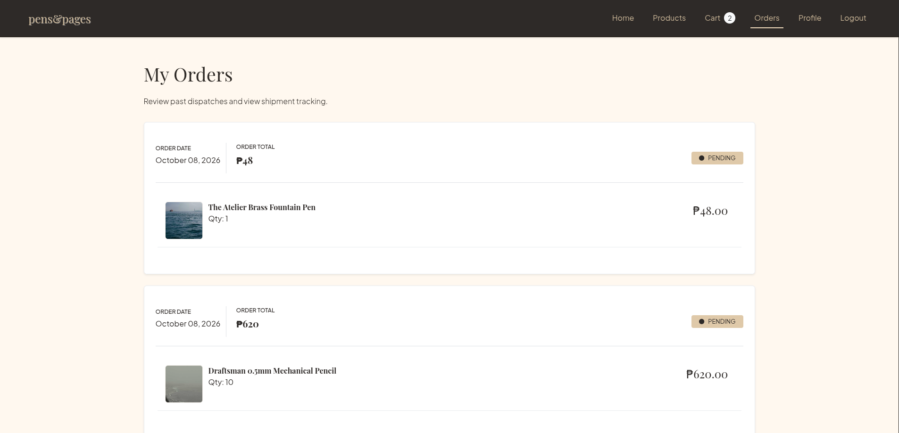
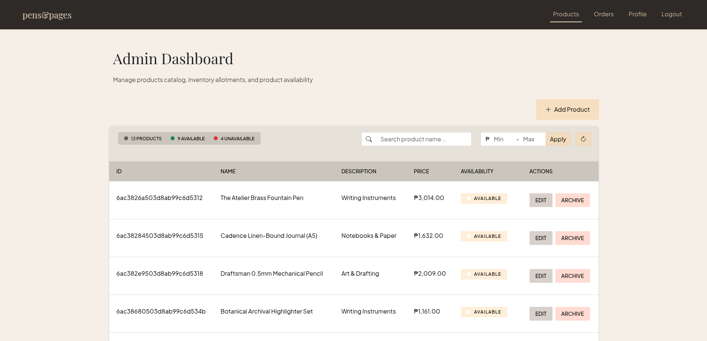

# pens&pages

An e-commerce web app with user authentication, a product catalog, cart & checkout, order history, and an admin dashboard for managing products and orders. Built as the third capstone of my coding bootcamp.

**Live demo:** https://pens-and-pages.vercel.app/
> The backend is hosted on Render's free tier, so the first request may take a few seconds to wake up.

## Demo Accounts
| Role | Email | Password |
|---|---|---|
| User | user@mail.com | user1234 |
| Admin | admin@mail.com | admin123 |

## Screenshots
<table>
<tbody>
<tr>
    <td>
        
    </td>
    <td>
        
    </td>
</tr>
<tr>
    <td>
        
    </td>
    <td>
        
    </td>
</tr>
</tbody>
</table>

## Features
- User registration and login
- Product catalog
- Cart and checkout
- Order history
- Admin dashboard for managing products and orders

## Technologies
- **Frontend:** Vue.js, Bootstrap
- **Backend:** Node.js, Express.js
- **Database:** MongoDB
- **Deployment:** Vercel (frontend), Render (backend)

## Local Installation

### Prerequisites
- Node.js
- A MongoDB database (local or Atlas)

### Installation
1. Clone the repo
   ```bash
   git clone https://github.com/syopao123/pens-and-pages
   cd pens-and-pages
   ```
2. Set up the backend
   ```bash
   cd server
   npm install
   cp .env.example .env   # then fill in your values
   npm run dev
   ```
3. Set up the frontend
   ```bash
   cd client
   npm install
   cp .env.example .env
   npm run dev
   ```

## Environment Variables
-  Server
   -  `PORT`
   -  `MONGODB_STRING`
   -  `JWT_SECRET_KEY`
   -  `CLIENT_URL`
- Client
  - `VITE_ECOMMERCE_API`